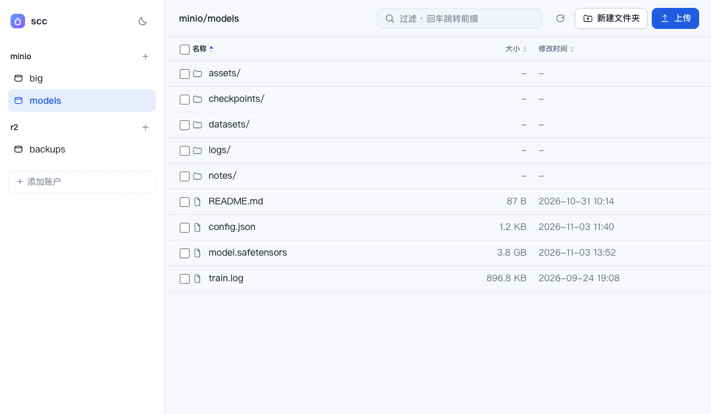

<div align="center">
  

  # scc

  *A small S3-compatible file browser — a single binary with a web UI and a CLI*

  [](https://go.dev)
  [](#installation)
  [](#configuration)

  [Features](#features) • [Installation](#installation) • [Getting started](#getting-started) • [Path syntax](#path-syntax) • [Command line](#command-line) • [Web UI](#web-ui) • [Configuration](#configuration) • [Development](#development)

  [中文](README.md) | **English**
</div>

`scc` browses any S3-compatible storage — MinIO, Ceph RGW, Cloudflare R2, Backblaze B2 and AWS S3 — from a browser or a shell, with both interfaces sharing the same implementation. Credentials for multiple accounts are stored in one local YAML file, so nothing needs to be deployed beyond the binary: no server-side state, no database, and adding an account takes a single command.

```bash
go build .                              # builds ./scc
./scc accounts add minio -endpoint http://127.0.0.1:9000 \
  -access-key minioadmin -secret-key minioadmin -default-bucket data
./scc web                               # start the web UI at http://127.0.0.1:8080
```

> [!TIP]
> To avoid storing secrets in the config file, use environment variables: `-access-key env:MINIO_KEY -secret-key env:MINIO_SECRET`.

## Features

- **One implementation, two front-ends.** The web UI and the CLI share the same operations layer, so listing, uploading and deleting behave identically in both.
- **Multiple accounts.** Add, switch and remove S3 accounts without editing JSON or restarting the service; the web UI reloads the configuration on every request, so changes take effect immediately.
- **Optional default bucket per account.** `acct:/dir/file` resolves inside the default bucket, keeping common paths short. Use `scc use acct://bucket` to switch the default bucket and `acct://bucket/key` to name a bucket explicitly.
- **In-browser preview.** Images, video and audio (with seeking), PDFs, text and code render inline; other file types can be downloaded in one click.
- **Confirmation for destructive actions.** Deleting a file, folder or bucket, as well as overwriting on upload or rename, requires confirmation in the UI.
- **Actionable error messages.** Common S3 failures (wrong secret, unknown access key, clock skew, denied access, non-empty bucket, TLS errors, unreachable host) print an additional actionable `hint:` line instead of the full raw SDK error.
- **Dark and light themes.** Follows the system setting, and the manual toggle preserves your choice.

## Installation

**Without Go:** Download a prebuilt binary from [Releases](https://github.com/akisaya/scc/releases) — macOS, Linux and Windows, arm64 included — and add `scc` to your `PATH`.

**With [Go 1.24+](https://go.dev/dl/):**

```bash
go install github.com/akisaya/scc@latest
# -> $(go env GOPATH)/bin/scc   (Windows: %USERPROFILE%\go\bin)
```

Or build from source:

```bash
git clone https://github.com/akisaya/scc && cd scc
go build .          # -> ./scc
```

## Getting started

Add an account to start browsing:

```bash
# self-hosted MinIO or Ceph: custom endpoints enable path-style addressing automatically
scc accounts add minio \
  -endpoint http://127.0.0.1:9000 \
  -access-key minioadmin -secret-key minioadmin \
  -default-bucket data

# Cloudflare R2
scc accounts add r2 \
  -endpoint https://<account-id>.r2.cloudflarestorage.com \
  -access-key env:R2_ACCESS_KEY -secret-key env:R2_SECRET_KEY

# AWS: omit the endpoint to use virtual-host addressing
scc accounts add aws -region ap-northeast-1 \
  -access-key env:AWS_ACCESS_KEY_ID -secret-key env:AWS_SECRET_ACCESS_KEY

scc accounts list     # secrets are not printed
scc ls minio:         # default bucket root
```

## Path syntax

Three forms; `//` always marks a bucket:

| Path | Meaning |
| --- | --- |
| `acct:` | Root of the account's default bucket (lists buckets when unset) |
| `acct:/dir/file` | Path inside the default bucket; an error when no default is configured |
| `acct://bucket/key` | That bucket, always, regardless of the default |

## Configuration

Accounts added with the `accounts` command are in fact stored in a YAML configuration file, shown below. You can also edit that file directly to add an account.

```yaml
listen: 127.0.0.1:8080
token: ""
accounts:
    - name: minio
      endpoint: http://127.0.0.1:9000
      region: us-east-1
      access_key: minioadmin
      secret_key: minioadmin
      path_style: true
      default_bucket: data
    - name: r2
      endpoint: https://<account-id>.r2.cloudflarestorage.com
      region: auto
      access_key: env:R2_ACCESS_KEY
      secret_key: env:R2_SECRET_KEY
      path_style: true
```

Configuration files are resolved in the following order, using the first one that exists:

1. `$SCC_CONFIG` (a full file path)
2. `$XDG_CONFIG_HOME/scc/config.yaml`
3. `~/.config/scc/config.yaml` — the same on macOS and Linux

`scc accounts list` prints the path currently in use. Any string value may be written as `env:NAME` and is resolved from the environment when used.

> [!NOTE]
> There is no database and no daemon: the configuration file is the only source of state. `accounts add` and the web form modify the same file, and the CLI and UI read the same file, so they cannot become inconsistent.

## Command line

```
scc <command> [args]
```

| Command | What it does |
| --- | --- |
| `accounts add <name> [flags]` | Add or update an account |
| `accounts list` / `accounts rm <name>` | List accounts / remove one |
| `use <acct>://bucket` | Make `bucket` the account's default (use `<acct>:` to clear) |
| `buckets <acct>` | List buckets regardless of the default |
| `ls <acct>:[/prefix]` / `<acct>://bucket[/prefix]` | List buckets, a directory, or a whole prefix |
| `cat <acct>:/key` / `<acct>://bucket/key` | Write an object to stdout |
| `cp [-r] <src> <dst>` | Copy local ↔ S3, or S3 → S3 |
| `rm [-r] <acct>:/key` / `<acct>://bucket/key` | Delete an object, or every object under a prefix |
| `mb` / `rb <acct>://bucket` | Create a bucket / delete an empty one (always explicit) |
| `web [-addr host:port]` | Start the browser UI |
| `version` | Print the version (stamped by the release build) |

Common examples:

```bash
scc buckets minio                       # list all buckets
scc ls minio:/reports                   # list one level
scc ls -r minio:/reports -n 20          # recursive listing, first 20 entries
scc cat minio:/reports/q3.pdf > q3.pdf
scc cp ./q4.pdf minio:/reports/         # upload a file
scc cp -r ./assets minio:/reports/      # upload a directory
scc cp -r minio:/reports/2025 ./reports-2025   # download a prefix
scc cp minio:/a.txt minio://data/b.txt  # server-side copy (explicit bucket)
scc rm -r minio:/tmp/                   # delete a prefix
```

> [!NOTE]
> `cp -r` copies the *contents* of a prefix into the destination directory, consistent with `aws s3 cp --recursive`, so the example above produces `./reports-2025/<keys under 2025>`. Use an explicit directory rather than `.` unless you intend to copy into the current directory.

> [!TIP]
> On a terminal, `ls` prints at most 100 entries and indicates that the output was truncated; `-n 0` prints everything. Output is never capped when piped or redirected, so scripts always receive the full listing. Flags may also follow the path, for example `scc ls minio:/reports -n 20`.

`mb`, `rb` and `use` always require `acct://bucket`, so a bucket name is never redirected by the default bucket.

## Web UI

`scc web` serves the UI and the JSON API from the same listener (default `127.0.0.1:8080`, or `listen` in the configuration):

<picture>
  <source media="(prefers-color-scheme: dark)" srcset="docs/screenshot-dark.png">
  
</picture>

- Accounts and buckets are listed in a sidebar; click `＋ 添加账户` to add or update an account.
- Directory browsing with breadcrumbs; the current path is stored in the URL (`#/account/bucket/prefix`), so refresh and back/forward navigation work correctly.
- Upload via button or drag and drop with progress display, plus create folder, download, rename, delete and create/delete buckets.
- The preview dialog shows the path, size and modification time, and provides `下载` and `新标签打开` actions.
- Directories are paginated: 200 entries per page, and `加载更多` appends more entries while showing the number loaded so far.
- The filter box searches only the entries that have been loaded and displays the number of matches, so a partial view is not mistaken for a complete one.
- A separate `跳到前缀` box jumps directly to an S3 prefix on Enter, including keys that have not been loaded.
- Every `/api/` request is logged with its status code and duration, making it easy to distinguish browser-side failures from server-side failures.

> [!WARNING]
> The server holds your S3 credentials, so it binds to loopback by default. To expose it on another network interface, set `token` in the configuration first: the UI then requires `?token=...` once (a cookie is set), or `Authorization: Bearer <token>`. There is no per-user access control; the token is a single shared secret.

## Web API

The UI is a lightweight client over these endpoints, so every UI operation can also be performed from a script:

| Method | Path | Purpose |
| --- | --- | --- |
| `GET` | `/api/accounts` | Accounts without secrets |
| `POST` | `/api/accounts` | Add or update (`replace: true` to overwrite) |
| `GET` | `/api/b/{acct}/buckets` | List buckets |
| `POST` | `/api/b/{acct}/buckets` | Create a bucket (`{"name": "..."}`) |
| `DELETE` | `/api/b/{acct}/buckets/{bucket}` | Delete an empty bucket |
| `GET` | `/api/b/{acct}/objects/{bucket}?prefix=&cursor=&limit=` | List a level or a prefix, one page at a time (`next_cursor`) |
| `GET` | `/api/b/{acct}/raw/{bucket}/{key}` | Stream an object (`Range`, `?download=1`) |
| `PUT` | `/api/b/{acct}/raw/{bucket}/{key}` | Upload |
| `DELETE` | `/api/b/{acct}/raw/{bucket}/{key}` | Delete (`?recursive=1` for a prefix) |
| `POST` | `/api/b/{acct}/copy` | Server-side copy `{from_bucket, from_key, to_bucket, to_key}` |

POST requests must use `Content-Type: application/json`, which also prevents cross-site form submissions from reaching these handlers.

## S3 compatibility

- **Addressing.** `scc accounts add` enables `path_style` when a custom `endpoint` is provided and leaves it disabled for AWS. A manually written configuration must set `path_style: true`; gateways such as MinIO and Ceph require it.
- **Checksums.** Flexible checksums are calculated only when an operation requires them, consistent with the expected behavior of R2 and B2.
- **Regions.** Defaults to `us-east-1` when unspecified; some gateways accept any value, while others reject an incorrect one.
- **Previewing** uses a streamed server-side proxy (with `Range` support) rather than presigned URLs, so private buckets require no CORS configuration and links never expire.
- **Uploads** use a single `PutObject`, so the S3 per-object limit of 5 GB applies. The web handler first buffers the request body to a temporary file because the SDK requires a rewindable body to calculate the hash.
- **Cross-account copy** is not supported: `cp` reports the limitation directly instead of failing with a confusing authentication error.

## Development

```
main.go                  entry point, error printing
internal/cli/            command parsing and the shared target resolution
internal/config/         YAML load/save, validation, secret indirection
internal/s3x/            AWS SDK client, listing/get/put/copy/delete, error hints
internal/web/            HTTP API, request logging, embedded UI
internal/web/static/     index.html, app.js, style.css (no build step)
scripts/                 release-notes.sh: CHANGELOG section -> GitHub Release body
test/                    end-to-end scripts against a real endpoint; test/mock/ is the local mock and seed data
```

```bash
go test ./...
go vet ./...

# end-to-end tests; any S3-compatible endpoint works (moto, MinIO, ...)
SCC_TEST_ENDPOINT=http://127.0.0.1:9000 ./test/e2e-cli.sh
SCC_TEST_ENDPOINT=http://127.0.0.1:9000 SCC_TEST_KEY=... SCC_TEST_SECRET=... ./test/e2e-web.sh
```


With no endpoint at hand, `test/mock/up.sh` starts a local moto and seeds demo data (the venv and moto are installed on first run):

```bash
./test/mock/up.sh                                  # http://127.0.0.1:19000, keys testkey / testsecret123
export SCC_CONFIG=$PWD/test/mock/.work/config.yaml # demo-only config, leaves ~/.config/scc alone
scc ls mock:/ && scc web
```

The seed data covers every preview branch (image / video / audio / PDF / text / no-preview), a 250-object directory for paging, deep prefixes, CJK and special-character keys, and a large object for `Range` requests. `--reset` drops and reseeds, `--server-only` starts the mock without data.

The end-to-end scripts create their own buckets with a random suffix, cover both path semantics (accounts with and without a default bucket), and stop immediately with a clear message when the endpoint is unreachable.

CI runs `gofmt`, `go vet`, `go test -race`, a syntax check of `app.js`, and both end-to-end scripts against an S3 mock (`moto`). Pushing a tag such as `v0.1.0` builds binaries for macOS, Linux and Windows, attaches them to a GitHub Release and uses the matching section of `CHANGELOG.md` as the release notes.

## Limitations

Designed for single-user use. Multipart or resumable uploads, presigned share links and object versioning are not supported; the UI provides no search or sorting, and cross-account copy is not available. The UI lists one S3 page (1000 keys) at a time; the CLI has no such limit and is intended for bulk operations. Emptying an entire bucket is deliberately not a single command: delete the intended prefixes so that a single mistake cannot wipe the bucket.
