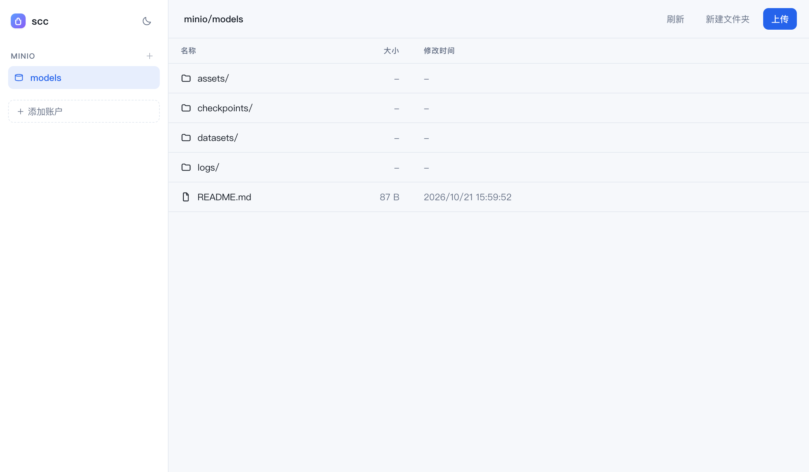

<div align="center">
  

  # scc

  *A small S3-compatible file browser — one binary, a web UI and a CLI*

  [](https://go.dev)
  [](#installation)
  [](#configuration)

  [Features](#features) • [Installation](#installation) • [Getting started](#getting-started) • [Command line](#command-line) • [Path syntax](#path-syntax) • [Web UI](#web-ui) • [Configuration](#configuration) • [Development](#development)

  [中文](README.md) | **English**
</div>

`scc` browses any S3-compatible storage — MinIO, Ceph RGW, Cloudflare R2, Backblaze B2, AWS S3 — from a browser or a shell, using the same code path for both. Credentials for several accounts live in one local YAML file, so there is nothing to deploy beyond the binary itself: no server-side state, no database, and adding another account is one line of CLI.

```bash
go build .                              # produces ./scc
./scc accounts add minio -endpoint http://127.0.0.1:9000 \
  -access-key minioadmin -secret-key minioadmin -default-bucket data
./scc web                               # http://127.0.0.1:8080
```

> [!TIP]
> Keep secrets out of the config file by pointing at the environment: `-access-key env:MINIO_KEY -secret-key env:MINIO_SECRET`.

## Features

- **Two front-ends, one binary.** The web UI and the CLI share the same operations layer, so listing, uploading and deleting behave identically in both.
- **Multiple accounts.** Add, switch and remove S3 accounts without touching JSON or restarting anything; the web UI picks up changes on the next request.
- **Default bucket per account.** `acct:/dir/file` resolves inside it, so day-to-day paths stay short. `scc use` switches it, `acct://bucket/key` names a bucket explicitly.
- **Preview in the browser.** Images, video and audio (with seeking), PDFs and text/code render inline; anything else gets a one-click download.
- **Everything destructive asks twice.** Deleting a file, a folder or a bucket — and overwriting on upload or rename — goes through an in-app confirmation.
- **Honest errors.** Common S3 failures (wrong secret, unknown key, clock skew, denied, non-empty bucket, TLS, unreachable host) print one actionable `hint:` line instead of raw SDK output.
- **Dark and light themes.** Follows the system setting, with a toggle that remembers your choice.

## Installation

**No Go?** Grab a prebuilt binary from [Releases](https://github.com/akisaya/scc/releases) — macOS, Linux and Windows, arm64 included — and put `scc` on your `PATH`.

**With [Go 1.24+](https://go.dev/dl/):** no clone needed.

```bash
go install github.com/akisaya/scc@latest
# -> $(go env GOPATH)/bin/scc   (Windows: %USERPROFILE%\go\bin)
```

Clone only if you want to change the code. The repository has no build step, no npm, and no generated code.

```bash
git clone https://github.com/akisaya/scc && cd scc
go build .          # -> ./scc
```

## Getting started

Add an account, then browse it:

```bash
# self-hosted MinIO or Ceph: path-style addressing is assumed for custom endpoints
scc accounts add minio \
  -endpoint http://127.0.0.1:9000 \
  -access-key minioadmin -secret-key minioadmin \
  -default-bucket data

# Cloudflare R2
scc accounts add r2 \
  -endpoint https://<account-id>.r2.cloudflarestorage.com \
  -access-key env:R2_ACCESS_KEY -secret-key env:R2_SECRET_KEY

# AWS: no endpoint, virtual-host addressing
scc accounts add aws -region ap-northeast-1 \
  -access-key env:AWS_ACCESS_KEY_ID -secret-key env:AWS_SECRET_ACCESS_KEY

scc accounts list     # secrets are never printed
scc ls minio:         # root of the default bucket
```

Object references look like `minio:/data/reports/q3.pdf`. Bare account names are validated: letters, digits, `-`, `_`, `.` (max 64 characters), because they appear in paths and URLs.

## Command line

```
scc <command> [args]
```

| Command | What it does |
| --- | --- |
| `accounts add <name> [flags]` | Add or update an account |
| `accounts list` / `accounts rm <name>` | List accounts / remove one |
| `use <acct>:/bucket` | Make `bucket` the account's default (omit it to clear) |
| `buckets <acct>` | List buckets regardless of the default |
| `ls <acct>:[/bucket[/prefix]] [-r] [-n N]` | List buckets, a directory, or a whole prefix |
| `cat <acct>:/bucket/key` | Write an object to stdout |
| `cp [-r] <src> <dst>` | Copy local ↔ S3, or S3 → S3 |
| `rm [-r] <acct>:/bucket/key` | Delete an object, or every object under a prefix |
| `mb` / `rb <acct>:/bucket` | Create a bucket / delete an empty one (always explicit) |
| `web [-addr host:port]` | Start the browser UI |
| `version` | Print the version (stamped by the release build) |

A tour:

```bash
scc buckets minio                       # what exists
scc ls minio:/reports                   # one level
scc ls -r minio:/reports -n 20          # first 20 of everything below
scc cat minio:/reports/q3.pdf > q3.pdf
scc cp ./q4.pdf minio:/reports/         # upload a file
scc cp -r ./assets minio:/reports/      # upload a directory
scc cp -r minio:/reports/2025 ./reports-2025   # download a prefix
scc cp minio:/a.txt minio:/b.txt        # server-side copy
scc rm -r minio:/tmp/                   # delete a prefix
```

> [!NOTE]
> `cp -r` copies the *contents* of a prefix into the destination directory, the way `aws s3 cp --recursive` does, so the example above produces `./reports-2025/<keys under 2025>`. Pass an explicit directory rather than `.` unless you really mean the current one.

> [!TIP]
> `ls` prints at most 100 entries on a terminal and says where it stopped; `-n 0` prints everything. When the output is piped or redirected it is never capped, so scripts keep seeing the full listing. Flags may come after the path — `scc ls minio:/reports -n 20` works as expected.

## Path syntax

Three forms, no guessing:

| Path | Meaning |
| --- | --- |
| `acct:` | Root of the account's default bucket (falls back to listing buckets when unset) |
| `acct:/dir/file` | Inside the default bucket. Without a default bucket, the first segment **is** the bucket |
| `acct://bucket/key` | That bucket, always, whether or not a default is configured |

> [!NOTE]
> Once a default bucket is set, `acct:/reports/` is a folder there — it is never mistaken for a bucket called `reports`. Use `scc use acct:/other` to move the default, or the double-slash form to reach another bucket in the same command, e.g. `scc cp acct:/a.txt acct://archive/a.txt`.

`mb` and `rb` always take an explicit bucket name, so creating a bucket can never be redirected at the default one.

## Web UI

`scc web` serves the UI and the JSON API from one listener (default `127.0.0.1:8080`, or `listen` in the config):

<picture>
  <source media="(prefers-color-scheme: dark)" srcset="docs/screenshot-dark.png">
  
</picture>

- Accounts and buckets in a sidebar; add or update an account from `＋ 添加账户`.
- Directory browsing with breadcrumbs; the current path lives in the URL (`#/account/bucket/prefix`), so refresh and back/forward behave.
- Upload by button or drag & drop with progress, new folder, download, rename, delete, create/delete buckets.
- Preview dialog shows path, size and mtime, with `下载` and `新标签打开`.
- Directories are paginated: 200 entries per page, and `加载更多` keeps appending while showing how many are loaded.
- The filter box searches only what has been loaded and says how many items matched, so a partial view is never mistaken for a full one.
- A separate `跳到前缀` box jumps straight to an S3 prefix on Enter, reaching keys that were never loaded.
- Every `/api/` request is logged with status and duration, which makes a browser-side failure easy to tell apart from a server-side one.

> [!WARNING]
> The server holds your S3 credentials. It binds to loopback by default for that reason. If you expose it on another interface, set `token` in the config first: the UI then requires `?token=...` once (a cookie is set) or `Authorization: Bearer <token>`. There is no per-user access control — the token is a single shared secret.

## Configuration

The file is plain YAML, written with mode `0600`:

```yaml
listen: 127.0.0.1:8080
token: ""
accounts:
    - name: minio
      endpoint: http://127.0.0.1:9000
      region: us-east-1
      access_key: minioadmin
      secret_key: minioadmin
      path_style: true
      default_bucket: data
    - name: r2
      endpoint: https://<account-id>.r2.cloudflarestorage.com
      region: auto
      access_key: env:R2_ACCESS_KEY
      secret_key: env:R2_SECRET_KEY
      path_style: true
```

Location, first match wins:

1. `$SCC_CONFIG` (a full file path)
2. `$XDG_CONFIG_HOME/scc/config.yaml`
3. `~/.config/scc/config.yaml` — the same on macOS and Linux

`scc accounts list` prints the path in use. Any string value may be written as `env:NAME` to be resolved from the environment at use time.

> [!NOTE]
> There is no database and no daemon: the config file is the only state. `accounts add` and the web form both rewrite it, and the CLI and UI never disagree because they read the same file.

## Web API

The UI is a thin client over these endpoints, so anything it does can be scripted:

| Method | Path | Purpose |
| --- | --- | --- |
| `GET` | `/api/accounts` | Accounts without secrets |
| `POST` | `/api/accounts` | Add or update (`replace: true` to overwrite) |
| `GET` | `/api/b/{acct}/buckets` | List buckets |
| `POST` | `/api/b/{acct}/buckets` | Create a bucket (`{"name": "..."}`) |
| `DELETE` | `/api/b/{acct}/buckets/{bucket}` | Delete an empty bucket |
| `GET` | `/api/b/{acct}/objects/{bucket}?prefix=&cursor=&limit=` | List a level or a prefix, one page at a time (`next_cursor`) |
| `GET` | `/api/b/{acct}/raw/{bucket}/{key}` | Stream an object (`Range`, `?download=1`) |
| `PUT` | `/api/b/{acct}/raw/{bucket}/{key}` | Upload |
| `DELETE` | `/api/b/{acct}/raw/{bucket}/{key}` | Delete (`?recursive=1` for a prefix) |
| `POST` | `/api/b/{acct}/copy` | Server-side copy `{from_bucket, from_key, to_bucket, to_key}` |

POST bodies must be `Content-Type: application/json`, which also keeps cross-site form posts away from these handlers.

## S3 compatibility

- **Addressing.** `scc accounts add` turns `path_style` on whenever a custom `endpoint` is given, and leaves it off for AWS. A hand-written config has to say `path_style: true` itself — gateways such as MinIO and Ceph need it.
- **Checksums.** Flexible checksums are only calculated when an operation requires them, which is what R2 and B2 expect.
- **Regions.** `us-east-1` unless specified; some gateways accept any value, others reject the wrong one.
- **Previewing** goes through the server (streamed, with `Range` support) rather than presigned URLs, so private buckets work without CORS setup and links never expire.
- **Uploads** are a single `PutObject`, so the S3 per-object limit of 5 GB applies. The web handler first buffers the request body to a temporary file, because the SDK needs a rewindable body in order to hash it.
- **Destination-copy** across accounts is not supported: `cp` reports it instead of failing with a confusing auth error.

## Development

```
main.go                  entry point, error printing
internal/cli/            command parsing and the shared target resolution
internal/config/         YAML load/save, validation, secret indirection
internal/s3x/            AWS SDK client, listing/get/put/copy/delete, error hints
internal/web/            HTTP API, request logging, embedded UI
internal/web/static/     index.html, app.js, style.css (no build step)
scripts/                 release-notes.sh: CHANGELOG section -> GitHub Release body
test/                    end-to-end scripts against a real endpoint
```

```bash
go test ./...
go vet ./...

# end-to-end; any S3-compatible endpoint works (moto, MinIO, ...)
SCC_TEST_ENDPOINT=http://127.0.0.1:9000 ./test/e2e-cli.sh
SCC_TEST_ENDPOINT=http://127.0.0.1:9000 SCC_TEST_KEY=... SCC_TEST_SECRET=... ./test/e2e-web.sh
```

The end-to-end scripts create their own buckets with a random suffix, check both path forms (an account with a default bucket and one without), and stop early with a clear message when the endpoint is unreachable.

CI runs `gofmt`, `go vet`, `go test -race`, a syntax check of `app.js`, and both end-to-end scripts against an S3 mock (`moto`). Pushing a tag such as `v0.1.0` builds binaries for macOS, Linux and Windows, attaches them to a GitHub Release, and uses the matching section of `CHANGELOG.md` as the release notes.

## Limitations

Single user by design. No multipart or resumable uploads, no presigned share links, no object versioning, no search or sorting in the UI, and no cross-account copy. The UI lists one S3 page (1000 keys) at a time; the CLI is uncapped and is the right tool for bulk work. Emptying a whole bucket is deliberately not a single command: delete the prefixes you mean, so one slip cannot wipe a bucket.
