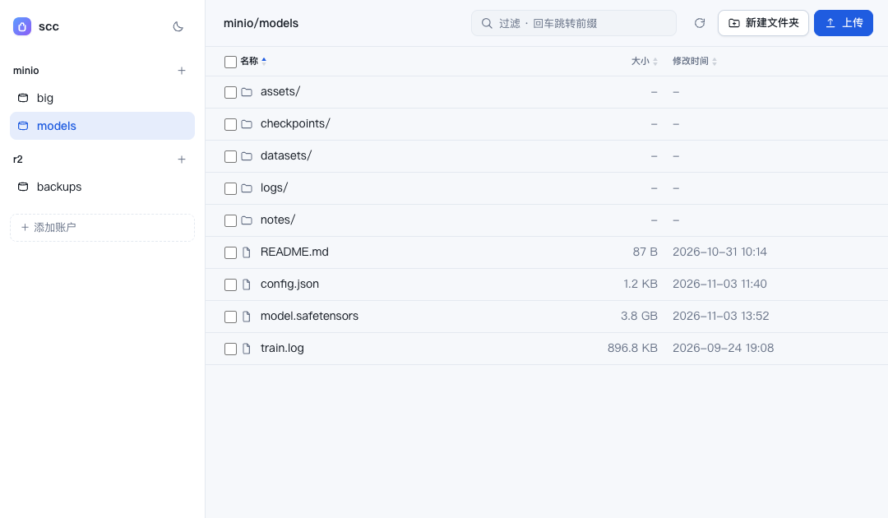

<div align="center">
  

  # scc

  *一个小巧的 S3 兼容文件浏览器 —— 单个二进制，同时提供网页界面与命令行*

  [](https://go.dev)
  [](#%E5%AE%89%E8%A3%85)
  [](#%E9%85%8D%E7%BD%AE)

  [功能](#功能) • [安装](#安装) • [快速开始](#快速开始) • [路径语法](#路径语法) • [命令行](#命令行) • [网页界面](#网页界面) • [配置](#配置) • [开发](#开发)

  **中文** | [English](README.en.md)
</div>

`scc` 支持在浏览器或终端中浏览任何 S3 兼容存储，包括 MinIO、Ceph RGW、Cloudflare R2、Backblaze B2 和 AWS S3，两种界面共用同一套实现。多账号凭证保存在一个本地 YAML 文件中，因此除二进制外无需部署其他组件：没有服务端状态，也没有数据库，添加账号只需一行命令。

```bash
go build .                              # 构建产物为 ./scc
./scc accounts add minio -endpoint http://127.0.0.1:9000 \
  -access-key minioadmin -secret-key minioadmin -default-bucket data
./scc web                               # 启动网页界面：http://127.0.0.1:8080
```

> [!TIP]
> 如需避免将密钥写入配置文件，可使用环境变量：`-access-key env:MINIO_KEY -secret-key env:MINIO_SECRET`。

## 功能

- **统一实现，两种界面。** 网页与命令行共用同一操作层，目录列表、上传和删除的行为完全一致。
- **多账号支持。** 增删和切换账号无需修改 JSON，也无需重启服务；网页每次请求都会重新读取配置，修改后立即生效。
- **每个账号可设置默认桶。** `acct:/dir/file` 直接定位到默认桶内，常用路径更简洁。使用 `scc use acct://bucket` 切换默认桶，使用 `acct://bucket/key` 显式指定桶。
- **浏览器内预览。** 图片、视频/音频（可拖动进度条）、PDF、文本和代码可内联显示，其他类型支持一键下载。
- **破坏性操作均需二次确认。** 删除文件、目录、桶，以及上传或重命名时的覆盖操作，都会弹出应用内确认框。
- **错误提示清晰可操作。** 常见 S3 故障（密钥错误、AK 不存在、时钟偏移、权限不足、桶非空、TLS 错误、无法连接）会额外输出一行可执行的 `hint:` 提示，而不是完整的 SDK 原始错误。
- **深色 / 浅色主题。** 默认跟随系统设置，手动切换后会保留选择。

## 安装

**未安装 Go：** 从 [Releases](https://github.com/akisaya/scc/releases) 下载对应平台的预编译包（macOS / Linux / Windows，含 arm64），解压后将 `scc` 放入 `PATH`。

**已安装 [Go 1.24+](https://go.dev/dl/)：**

```bash
go install github.com/akisaya/scc@latest
# -> $(go env GOPATH)/bin/scc   (Windows: %USERPROFILE%\go\bin)
```

或者从 source 构建

```bash
git clone https://github.com/akisaya/scc && cd scc
go build .          # -> ./scc
```

## 快速开始

添加账号后即可开始浏览：

```bash
# 自建 MinIO / Ceph：填写自定义 endpoint 时会自动启用 path-style 寻址
scc accounts add minio \
  -endpoint http://127.0.0.1:9000 \
  -access-key minioadmin -secret-key minioadmin \
  -default-bucket data

# Cloudflare R2
scc accounts add r2 \
  -endpoint https://<account-id>.r2.cloudflarestorage.com \
  -access-key env:R2_ACCESS_KEY -secret-key env:R2_SECRET_KEY

# AWS：不填写 endpoint，使用虚拟主机寻址
scc accounts add aws -region ap-northeast-1 \
  -access-key env:AWS_ACCESS_KEY_ID -secret-key env:AWS_SECRET_ACCESS_KEY

scc accounts list     # 不会输出 secret
scc ls minio:         # 默认桶根目录
```

## 路径语法

三种写法，`//` 始终表示桶名：

| 路径 | 含义 |
| --- | --- |
| `acct:` | 账号默认桶的根目录（未设置默认桶时列出桶） |
| `acct:/dir/file` | 默认桶内的路径；未设置默认桶时为错误 |
| `acct://bucket/key` | 显式指定的桶，始终不受默认桶影响 |

## 配置
通过 account 命令添加的账号实际存储在一个 yaml 配置文件中，如下所示。也可以直接修改配置文件添加账号

```yaml
listen: 127.0.0.1:8080
token: ""
accounts:
    - name: minio
      endpoint: http://127.0.0.1:9000
      region: us-east-1
      access_key: minioadmin
      secret_key: minioadmin
      path_style: true
      default_bucket: data
    - name: r2
      endpoint: https://<account-id>.r2.cloudflarestorage.com
      region: auto
      access_key: env:R2_ACCESS_KEY
      secret_key: env:R2_SECRET_KEY
      path_style: true
```

配置文件优先级如下，取第一个存在的文件：

1. `$SCC_CONFIG`（完整文件路径）
2. `$XDG_CONFIG_HOME/scc/config.yaml`
3. `~/.config/scc/config.yaml` —— macOS 和 Linux 一致

`scc accounts list` 会输出当前实际使用的路径。任何字符串值均可写成 `env:NAME`，在使用时从环境变量读取。

> [!NOTE]
> 没有数据库，也没有常驻服务：配置文件是唯一的状态来源。`accounts add` 和网页表单修改的是同一个文件，CLI 与界面读取的也是同一个文件，因此不会出现状态不一致。

## 命令行

```
scc <command> [args]
```

| 命令 | 作用 |
| --- | --- |
| `accounts add <name> [flags]` | 添加或更新账号 |
| `accounts list` / `accounts rm <name>` | 列出账号 / 删除账号 |
| `use <acct>://bucket` | 把 `bucket` 设为该账号的默认桶（使用 `<acct>:` 清除） |
| `buckets <acct>` | 列桶，不受默认桶影响 |
| `ls <acct>:[/prefix]` / `<acct>://bucket[/prefix]` | 列桶、列目录，或列整个前缀 |
| `cat <acct>:/key` / `<acct>://bucket/key` | 把对象写到标准输出 |
| `cp [-r] <src> <dst>` | 本地与 S3 互拷，或 S3 之间拷贝 |
| `rm [-r] <acct>:/key` / `<acct>://bucket/key` | 删除一个对象，或删除某个前缀下的全部对象 |
| `mb` / `rb <acct>://bucket` | 创建桶 / 删除空桶（必须写桶名） |
| `web [-addr host:port]` | 启动网页界面 |
| `version` | 打印版本号（由发布构建注入） |

常用示例：

```bash
scc buckets minio                       # 列出所有桶
scc ls minio:/reports                   # 列出下一层
scc ls -r minio:/reports -n 20          # 递归列出，仅显示前 20 条
scc cat minio:/reports/q3.pdf > q3.pdf
scc cp ./q4.pdf minio:/reports/         # 上传文件
scc cp -r ./assets minio:/reports/      # 上传目录
scc cp -r minio:/reports/2025 ./reports-2025   # 下载一个前缀
scc cp minio:/a.txt minio://data/b.txt  # 服务端直接拷贝（显式桶）
scc rm -r minio:/tmp/                   # 删除一个前缀
```

> [!NOTE]
> `cp -r` 会将前缀的**内容**复制到目标目录（行为与 `aws s3 cp --recursive` 一致），因此上述示例会得到 `./reports-2025/<2025 下的 key>`。请使用明确的目录，除非确实希望复制到当前目录。

> [!TIP]
> 在终端中，`ls` 最多输出 100 条，并提示结果已截断；`-n 0` 可输出全部。通过管道或重定向输出时不会截断，脚本行为不受影响。选项也可写在路径之后，例如 `scc ls minio:/reports -n 20`。

`mb`、`rb` 和 `use` 始终要求使用 `acct://bucket` 形式，因此桶名不会被“默认桶”重定向。

## 网页界面

`scc web` 通过同一监听端口提供界面与 JSON API（默认为 `127.0.0.1:8080`，或使用配置中的 `listen`）：

<picture>
  <source media="(prefers-color-scheme: dark)" srcset="docs/screenshot-dark.png">
  
</picture>

- 侧栏列出账号和桶，点击 `＋ 添加账户` 可直接新增或更新账号。
- 目录浏览支持面包屑；当前路径会写入 URL（`#/account/bucket/prefix`），刷新和前进/后退均可正常使用。
- 上传支持按钮和拖拽操作，并显示进度；此外还支持新建文件夹、下载、重命名、删除以及创建/删除桶。
- 预览弹窗显示路径、大小和修改时间，并提供 `下载` 和 `新标签打开` 操作。
- 目录采用分页加载：每页 200 条，底部的「加载更多」会持续追加内容并显示已加载数量，无需一次性加载完整目录。
- 顶部搜索框一个控件两用：输入即过滤**已加载**的项（底部会说明只在已加载的部分里查找），按回车则把输入当作 S3 前缀直接跳转，不受已加载页数限制。
- 点击表头可循环切换排序状态：升序 → 降序 → 恢复默认顺序（即服务端返回的 key 顺序），不会陷在某个排序里出不来。名称顺序与 `scc ls` 一致（目录在前，组内按 key 字典序）。修改时间按 `2026-11-03 01:42` 显示，悬停可看含秒的完整时间。
- 每行左侧的勾选框支持多选，选择后可批量下载或批量删除；行内操作是图标按钮，悬停时才出现。
- 上传与重命名在覆盖前会先向服务端确认目标 key 是否存在，目标不在已加载的页里也不会静默覆盖。
- 每个 `/api/` 请求都会将状态码和耗时记录到日志中，便于区分浏览器端和服务端的失败。

> [!WARNING]
> 该服务持有 S3 凭证，因此默认仅绑定回环地址。如需在其他网络接口上暴露，请先在配置中设置 `token`：此后访问界面需先通过 `?token=...` 完成一次认证（会写入 cookie），或使用 `Authorization: Bearer <token>`。服务不提供按用户划分的权限控制，token 仅作为共享密钥使用。

## Web API

界面是这些接口的轻量客户端，因此界面上的操作均可通过脚本完成：

| 方法 | 路径 | 用途 |
| --- | --- | --- |
| `GET` | `/api/accounts` | 账号列表（不含 secret） |
| `POST` | `/api/accounts` | 添加或更新（`replace: true` 表示覆盖） |
| `GET` | `/api/b/{acct}/buckets` | 列桶 |
| `POST` | `/api/b/{acct}/buckets` | 创建桶（`{"name": "..."}`） |
| `DELETE` | `/api/b/{acct}/buckets/{bucket}` | 删除空桶 |
| `GET` | `/api/b/{acct}/objects/{bucket}?prefix=&cursor=&limit=` | 列一层或列前缀，一页一条游标（`next_cursor`） |
| `GET` | `/api/b/{acct}/raw/{bucket}/{key}` | 流式读取对象（支持 `Range`、`?download=1`） |
| `PUT` | `/api/b/{acct}/raw/{bucket}/{key}` | 上传 |
| `DELETE` | `/api/b/{acct}/raw/{bucket}/{key}` | 删除（`?recursive=1` 删前缀） |
| `POST` | `/api/b/{acct}/copy` | 服务端拷贝 `{from_bucket, from_key, to_bucket, to_key}` |
| `POST` | `/api/b/{acct}/stat` | 批量判断 key 是否存在：`{bucket, keys}` → `{existing}`（最多 200 个） |

POST 请求必须携带 `Content-Type: application/json`，这同时可阻止跨站表单提交。

## S3 兼容性

- **寻址方式。** 填写自定义 `endpoint` 时，`scc accounts add` 会自动启用 `path_style`；AWS 则关闭该选项。手动编写配置文件时需自行设置 `path_style: true`，MinIO、Ceph 等网关需要此配置。
- **校验和。** 仅在操作确实需要时计算 flexible checksum，符合 R2 和 B2 的预期行为。
- **Region。** 未指定时默认为 `us-east-1`；部分网关接受任意值，部分网关会拒绝错误的值。
- **预览** 通过服务端流式代理（支持 `Range`）实现，而非预签名 URL，因此私有桶无需配置 CORS，链接也不会过期。浏览器会当作文档渲染的类型（`html`、`svg`、`xml`）带 `sandbox` CSP 返回：可以查看，但其中的脚本不会执行，也不会带本服务的身份去调用 `/api/`。
- **上传** 使用单次 `PutObject`，受 S3 单对象 5 GB 上限约束。网页端会先将请求体写入临时文件，因为 SDK 需要一个可回退的 body 来计算哈希。
- **跨账号拷贝** 不受支持：`cp` 会直接报错，避免产生容易混淆的鉴权失败。

## 开发

```
main.go                  入口，错误输出
internal/cli/            命令解析与路径解析（默认桶逻辑在这里）
internal/config/         YAML 读写、校验、密钥环境变量替换
internal/s3x/            AWS SDK 客户端、列目录/读写/拷贝/删除、错误提示
internal/web/            HTTP API、请求日志、内嵌界面
internal/web/static/     index.html、style.css、theme.js；js/ 下是界面的 ES 模块，入口 main.js（无构建步骤）
test/web/                不碰 DOM 的前端模块的单测（node --test）
scripts/                 release-notes.sh：把 CHANGELOG 段落转成 Release 正文
test/                    针对真实 endpoint 的端到端脚本；test/mock/ 是本地 mock 与演示数据
```

```bash
go test ./...
go vet ./...
node --test 'test/web/*.test.js'   # 前端单测，需要 Node 22+

# 端到端测试；支持任意 S3 兼容 endpoint（moto、MinIO 等）
SCC_TEST_ENDPOINT=http://127.0.0.1:9000 ./test/e2e-cli.sh
SCC_TEST_ENDPOINT=http://127.0.0.1:9000 SCC_TEST_KEY=... SCC_TEST_SECRET=... ./test/e2e-web.sh
```

没有现成 endpoint 时，`test/mock/up.sh` 会起一个本地 moto 并灌好演示数据（首次运行自动创建 venv 并安装 moto）：

```bash
./test/mock/up.sh                                  # http://127.0.0.1:19000，凭证 testkey / testsecret123
export SCC_CONFIG=$PWD/test/mock/.work/config.yaml # 演示专用配置，不碰 ~/.config/scc
scc ls mock:/ && scc web
```

演示数据覆盖图片 / 视频 / 音频 / PDF / 文本 / 无预览类型的预览分支、250 个对象的分页、深层目录、中文与特殊字符 key，以及用于 Range 测试的大文件。`--reset` 丢弃后重灌，`--server-only` 只起服务。

端到端脚本会自动创建带随机后缀的桶，覆盖两种路径语义（有默认桶和无默认桶的账号），并在 endpoint 不可达时立即给出明确提示。

CI 会运行 `gofmt`、`go vet`、`go test -race`、前端模块的语法检查与单测，以及针对 S3 mock（`moto`）的两套端到端脚本。推送 `v0.1.0` 等 tag 时会构建 macOS / Linux / Windows 二进制并附加到 GitHub Release，同时使用 `CHANGELOG.md` 中对应段落作为发布说明。

## 限制

按单用户场景设计。不支持分片或断点续传上传、预签名分享链接、对象版本管理。界面里的过滤只作用于已加载的项（跨目录搜索请用命令行），批量下载由浏览器逐个触发，文件多时可能被拦截；大批量操作建议使用命令行。不支持跨账号拷贝。清空整个桶有意不提供单条命令，只能按前缀删除，以避免误操作清空整个桶。
