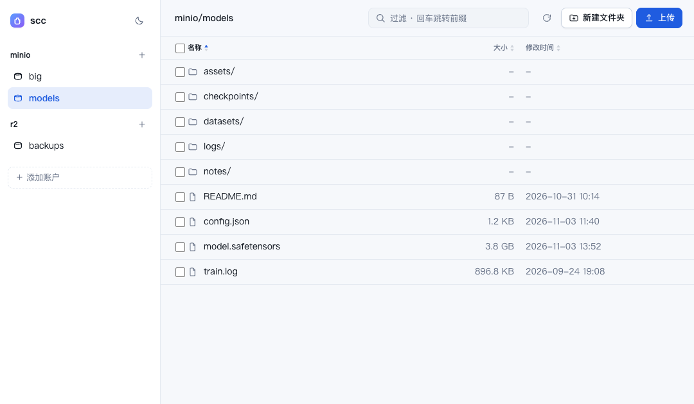

<div align="center">
  

  # scc

  *`SCC(S3 Compatible Client)` 支持在浏览器或终端中浏览任何 S3 兼容存储*

  [](https://go.dev)
  [](#%E5%AE%89%E8%A3%85)
  [](#%E9%85%8D%E7%BD%AE)

  [功能](#功能) • [安装](#安装) • [开始使用](#开始使用) • [路径语法](#路径语法) • [命令行](#命令行) • [配置](#配置) • [文档](#文档)
</div>

## 功能

- **统一实现，两种界面。** 网页与命令行共用同一操作层，目录列表、上传和删除的行为完全一致。
- **多账号支持。** 增删和切换账号无需重启服务；网页每次请求都会重新读取配置，修改后立即生效。
- **每个账号可设置默认桶。** `acct:/dir/file` 直接定位到默认桶内，常用路径更简洁。
- **浏览器内预览。** 图片、视频、音频、PDF、文本和代码可内联显示。

## 安装

**未安装 Go：** 从 [Releases](https://github.com/akisaya/scc/releases) 下载对应平台的预编译包（macOS arm64 / Linux amd64 / Windows amd64），解压后将 `scc` 放入 `PATH`。

**已安装 [Go 1.24+](https://go.dev/dl/)：**

```bash
go install github.com/akisaya/scc@latest
# -> $(go env GOPATH)/bin/scc   (Windows: %USERPROFILE%\go\bin)
```

或者从源码构建：

```bash
git clone https://github.com/akisaya/scc && cd scc
go build .          # -> ./scc
```

## 开始使用

```bash
# 自定义 endpoint 会自动启用 path-style 寻址，适合自建 MinIO / Ceph
scc accounts add minio \
  -endpoint http://127.0.0.1:9000 \
  -access-key minioadmin -secret-key minioadmin \
  -default-bucket data

scc accounts list     # 不会输出 secret
scc ls minio:         # 默认桶根目录
scc web               # 网页界面
```

> [!TIP]
> 只需在 `-access-key` / `-secret-key` 中写成 `env:NAME`，即可避免把密钥写入配置文件，取值在使用时从环境变量读取。

更多账号添加方式见 [命令行说明](docs/cli.md#添加账号)。

## 路径语法

三种写法，`//` 始终表示桶名：

| 路径 | 含义 |
| --- | --- |
| `acct:` | 账号默认桶的根目录（未设置默认桶时列出桶） |
| `acct:/dir/file` | 默认桶内的路径；未设置默认桶时为错误 |
| `acct://bucket/key` | 显式指定的桶，始终不受默认桶影响 |

## 命令行

```
scc <command> [args]
```

| 命令 | 作用 |
| --- | --- |
| `accounts add <name> [flags]` | 添加或更新账号 |
| `accounts list` / `accounts rm <name>` | 列出账号 / 删除账号 |
| `use <acct>://bucket` | 把 `bucket` 设为该账号的默认桶（使用 `<acct>:` 清除） |
| `buckets <acct>` | 列桶，不受默认桶影响 |
| `ls [-p] [-r] <acct>:[/path]` / `<acct>://bucket[/path]` | 列桶、文件或目录；`-p` 按原始前缀匹配，`-r` 展开所有层级 |
| `cat <acct>:/key` / `<acct>://bucket/key` | 把对象写到标准输出 |
| `cp [-p] [-r] [--skip-existing] <src> <dst>` | 本地与 S3 互拷，或 S3 之间拷贝；可跳过已有目标 |
| `get [-p] [-r] [--skip-existing] <src> [dst]` | 下载到本地，省略目标时保存到当前目录；可跳过已有文件 |
| `put [-r] [--skip-existing] <src> <dst>` | 上传本地文件或目录内容到 S3；可跳过已有对象 |
| `rm [-p] [-r] [--dry-run] <S3-path>` | 删除文件或目录；`-p` 按原始前缀匹配，`--dry-run` 预览 |
| `mb` / `rb <acct>://bucket` | 创建桶 / 删除空桶（必须写桶名） |
| `web [-addr host:port]` | 启动网页界面 |
| `version` | 打印版本号（由发布构建注入） |
| `help [command]` / `<command> --help` | 显示用法、参数和示例 |

```bash
scc ls minio:/abc.txt                  # 列出指定文件的大小、修改时间和名称
scc ls -p minio:/reports/202           # 按前缀寻找文件或目录，只展示一层
scc ls -p -r minio:/reports/202         # 展开全部匹配对象，输出完整 key
scc ls -r minio:/reports/ -n 20         # 递归列出前 20 条，输出完整 key
scc ls minio:/reports/ -n 0 |
  awk '$1 == "DIR" { n++ } END { print n + 0 }'  # 统计直接子目录数
scc ls -r minio:/reports/ -n 0 |
  awk 'END { print NR + 0 }'                     # 统计全部对象数
scc put -r ./assets minio:/reports/     # 上传目录内容
scc get minio:/abc.txt                # 下载到当前目录的 abc.txt
scc get -r minio:/reports/2025 ./out   # 下载指定目录的内容
scc get -p -r minio:/reports/202 ./out # 按前缀下载到 out/2025/... 等路径
scc get -r --skip-existing minio:/reports ./out # 重复下载时跳过已有文件
scc rm -r --dry-run minio:/tmp         # 预览将删除的对象
scc help get                          # 查看命令帮助
```

> [!NOTE]
> `ls`、`get`、`rm` 和以 S3 为源的 `cp` 默认优先选择完整 key 对应的文件，没有同名文件时补 `/` 操作指定目录；文件与目录同名时，用结尾 `/` 指定目录。`-p` 使用原始 S3 prefix，不补 `/`、不优先选择文件；`-r` 只控制是否展开所有目录层级。需要沿用旧版递归前缀匹配时，请使用 `-p -r`。

> [!WARNING]
> `rm -p -r` 会操作所有同前缀对象，执行前可用 `--dry-run` 查看准确范围。`rm -r docs` 则只删除 `docs/`，不会匹配到 `docs-old/`。

下载完成后才替换本地目标文件，传输失败保留原文件并清理临时文件。`get`、`cp` 在终端中显示进度、大小和速度，结束时在 stderr 汇报文件数、总大小及跳过数量；通过管道或重定向输出时关闭动态进度。

完整示例、各命令的 prefix 语义、目录与完整 key 的区别、数量统计、`cp -r` 的复制语义与终端输出截断规则见 [命令行说明](docs/cli.md)。

## 配置

账号实际存储在 YAML 配置文件中，也可以直接编辑该文件：

```yaml
listen: 127.0.0.1:8080
token: ""
accounts:
    - name: minio
      endpoint: http://127.0.0.1:9000
      region: us-east-1
      access_key: minioadmin
      secret_key: minioadmin
      path_style: true
      default_bucket: data
```

配置文件按以下顺序取第一个存在的：`$SCC_CONFIG` → `$XDG_CONFIG_HOME/scc/config.yaml` → `~/.config/scc/config.yaml`。`scc accounts list` 会输出当前实际使用的路径。字段含义与 `env:` 语法见 [配置说明](docs/cli.md#配置)。

## 网页界面

`scc web` 通过同一监听端口提供界面与 JSON API：

<picture>
  <source media="(prefers-color-scheme: dark)" srcset="docs/screenshot-dark.png">
  
</picture>

- 侧栏列出账号和桶，点击 `＋ 添加账户` 可直接新增或更新账号。
- 目录浏览支持面包屑，当前路径写入 URL（`#/account/bucket/prefix`），刷新和前进/后退均可用。
- 上传支持按钮与拖拽并显示进度，另有新建文件夹、下载、重命名、删除和桶管理。
- 目录分页加载（每页 200 条），搜索框可过滤已加载项或按前缀直接跳转，列头点击循环切换排序。
- 全程可用键盘操作，支持多选批量下载/删除，窄屏（640px 以下）时侧栏收进抽屉。

> [!WARNING]
> 该服务持有 S3 凭证，默认仅绑定回环地址。如需暴露到其他网络接口，请先在配置中设置 `token`。

## 文档

| 文档 | 内容 |
| --- | --- |
| [命令行说明](docs/cli.md) | 路径语义、全部命令与示例、配置字段、`env:` 语法 |
| [网页界面说明](docs/web.md) | 界面交互细节、安全提示、Web API |
| [开发说明](docs/development.md) | 目录结构、单元与端到端测试、mock 环境、CI、S3 兼容性、已知限制 |

## 限制

按单用户场景设计：不支持分片或断点续传上传、预签名分享链接、对象版本管理与跨账号拷贝；界面过滤只作用于已加载的项，大批量操作建议使用命令行。清空整个桶有意不提供单条命令，只能按前缀删除。
