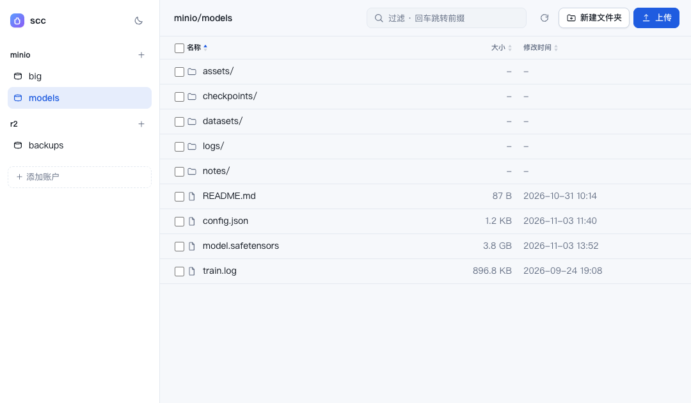

# 网页界面与 Web API

首页见 [README](../README.md)。

## 启动

`scc web` 通过同一监听端口提供界面与 JSON API（默认为 `127.0.0.1:8080`，或使用配置中的 `listen`）。可用 `-addr host:port` 临时覆盖。

<picture>
  <source media="(prefers-color-scheme: dark)" srcset="screenshot-dark.png">
  
</picture>

## 界面行为

- 侧栏列出账号和桶，点击 `＋ 添加账户` 可直接新增或更新账号。
- 侧栏品牌旁显示当前运行二进制的版本；发布构建中的值与 `scc version` 一致。
- 目录浏览支持面包屑；当前路径会写入 URL（`#/account/bucket/prefix`），刷新和前进/后退均可正常使用。
- 上传支持按钮和拖拽操作，并显示进度；此外还支持新建文件夹、下载、重命名、删除以及创建/删除桶。
- 预览弹窗显示路径、大小和修改时间，并提供 `下载` 和 `新标签打开` 操作。图片、视频/音频（可拖动进度条）、PDF、文本和代码可内联显示，其他类型支持一键下载。
- 目录采用分页加载：每页 200 条，底部的「加载更多」会持续追加内容并显示已加载数量，无需一次性加载完整目录。
- 顶部搜索框一个控件两用：输入即过滤**已加载**的项（底部会说明只在已加载的部分里查找），按回车则把输入当作 S3 前缀直接跳转，不受已加载页数限制。
- 点击表头可循环切换排序状态：升序 → 降序 → 恢复默认顺序（即服务端返回的 key 顺序），不会陷在某个排序里出不来。名称顺序与 `scc ls` 一致（目录在前，组内按 key 字典序）。修改时间按 `2026-11-03 01:42` 显示，悬停可看含秒的完整时间。
- 每行左侧的勾选框支持多选，选择后可批量下载或批量删除；行内操作是图标按钮，悬停或键盘聚焦到该行时出现。
- 全程可用键盘：Tab 走到桶、面包屑和每一行，回车打开，↑/↓ 在行间移动，Delete（或 ⌘⌫）删除当前行（会先确认）。桶、目录和面包屑都是真链接，中键或 ⌘ 点击可在新标签打开。
- 预览弹窗里用 ←/→ 或标题栏的箭头切换到上一个/下一个文件，顺序与当前列表（含过滤和排序）一致。
- 窄屏（640px 以下）时侧栏收进左上角的抽屉，面包屑单独占一行。
- 上传和批量删除的进度条与操作提示分开显示，提示最多叠放三条，不会把进行中的进度条顶掉。
- 上传与重命名在覆盖前会先向服务端确认目标 key 是否存在，目标不在已加载的页里也不会静默覆盖。
- 每个 `/api/` 请求都会将状态码和耗时记录到日志中，便于区分浏览器端和服务端的失败。
- 破坏性操作（删除文件、目录、桶，以及上传或重命名时的覆盖）都会弹出应用内确认框。
- 默认跟随系统的深色 / 浅色主题，手动切换后会保留选择。

## 安全

> [!WARNING]
> 该服务持有 S3 凭证，因此默认仅绑定回环地址。如需在其他网络接口上暴露，请先在配置中设置 `token`：此后访问界面需先通过 `?token=...` 完成一次认证（会写入 cookie），或使用 `Authorization: Bearer <token>`。服务不提供按用户划分的权限控制，token 仅作为共享密钥使用。

## Web API

界面是这些接口的轻量客户端，因此界面上的操作均可通过脚本完成：

| 方法 | 路径 | 用途 |
| --- | --- | --- |
| `GET` | `/api/accounts` | 账号列表（不含 secret） |
| `POST` | `/api/accounts` | 添加或更新（`replace: true` 表示覆盖） |
| `GET` | `/api/b/{acct}/buckets` | 列桶 |
| `POST` | `/api/b/{acct}/buckets` | 创建桶（`{"name": "..."}`） |
| `DELETE` | `/api/b/{acct}/buckets/{bucket}` | 删除空桶 |
| `GET` | `/api/b/{acct}/objects/{bucket}?prefix=&cursor=&limit=` | 列一层或列前缀，一页一条游标（`next_cursor`） |
| `GET` | `/api/b/{acct}/raw/{bucket}/{key}` | 流式读取对象（支持 `Range`、`?download=1`） |
| `PUT` | `/api/b/{acct}/raw/{bucket}/{key}` | 上传 |
| `DELETE` | `/api/b/{acct}/raw/{bucket}/{key}` | 删除（`?recursive=1` 删前缀） |
| `POST` | `/api/b/{acct}/copy` | 服务端拷贝 `{from_bucket, from_key, to_bucket, to_key}` |
| `POST` | `/api/b/{acct}/stat` | 批量判断 key 是否存在：`{bucket, keys}` → `{existing}`（最多 200 个） |

POST 请求必须携带 `Content-Type: application/json`，这同时可阻止跨站表单提交。
